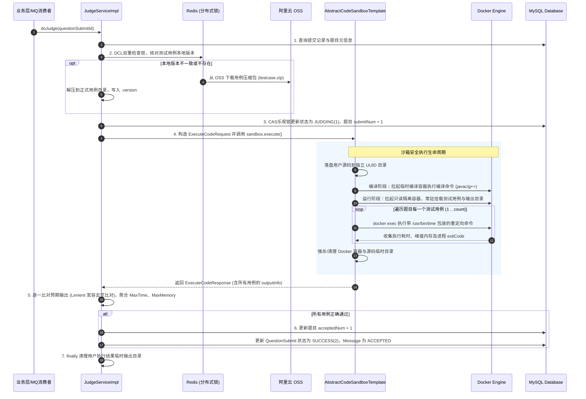

`JudgeService` 从触发 `doJudge(questionSubmitId)` 到最终判题成功（`ACCEPTED`）的完整业务逻辑、执行链路以及涉及的底层核心命令深度解析如下：

---

### 一、整体判题全景流程图



---

### 二、端到端 6 大核心执行阶段

#### 阶段 1：前置准备与提交状态防重
1. 根据 `questionSubmitId` 获取提交实体并校验其关联的 `Question` 是否存在。
2. **状态防并发**：校验当前记录状态必须为 `WAITING(0)`。防止消息队列重复投递或用户并发重放导致重复判题。

#### 阶段 2：测试用例按需同步（DCL 双重检查锁 + OSS 同步）
为保证判题机极速运行，测试用例**绝不每次从 OSS 远程拉取**，而是缓存于本地宿主机目录：
1. **轻量初检**：对比本地用例目录下的 `.version` 文件内容与题目数据库中的 `judgeCaseVersion`。如果一致，直接跳过下载。
2. **DCL 分布式锁同步**：
   - 若不一致，通过 Redisson 获取针对该题目粒度的锁 `lock:judge:testcase:{questionId}`。
   - 获取锁后进行**二次检查**（防止并发进来的后续线程重复下载）。
   - 从 OSS 增量下载对应版本的 `testcase.zip` 到临时目录，解压并写入 `.version`，再原子覆盖到正式目录。

#### 阶段 3：状态流转与提交计数
1. 使用 CAS 乐观更新：将 `QuestionSubmit` 状态由 `WAITING(0)` 更改为 `JUDGING(1)`。
2. 题目提交数累加：`submitNum = submitNum + 1`。

#### 阶段 4：沙箱执行生命周期（Docker 安全加固）
沙箱采用**模板方法设计模式**（`AbstractCodeSandboxTemplate`），屏蔽具体语言差异：
1. **源码落盘**：在宿主机 `${oj.path.code}/{uuid}` 创建独立目录，根据语言写入标准文件名（如 `Main.java`、`main.cpp`、`main.py`）。
2. **编译隔离**：
   - 若为 Python 等解释型语言，跳过编译；
   - 若为 Java/C++，启动一个配额 256MB 的编译容器，读写挂载该代码目录。
   - 检查编译退出码 `exitCode`，若失败则提取 `stderr` 包装为 `COMPILE_ERROR` 返回。
3. **多用例批量执行**：
   - 启动一个高度安全隔离的运行容器。
   - 容器挂载：
     - `/app/code`（代码目录）：**只读（ro）**，防止用户恶意篡改或删除代码。
     - `/app/testcase`（输入用例）：**只读（ro）**，防止输入数据被破坏。
     - `/app/result`（输出结果）：**读写（rw）**，写入各用例的标准输出、错误日志及监控数据。
   - 依次向容器发送 `execCreateCmd`，使用 `/usr/bin/time` 启动用户程序，逐一输入测试数据并记录输出。

#### 阶段 5：结果比对与裁决（Verdict Aggregation）
沙箱执行完毕后，`JudgeServiceImpl` 对比测试结果：
1. **非预期终止判定**：检查各用例的 `outputInfo.getMessage()`：
   - `exitCode == 137 || exitCode == 9` $\rightarrow$ 标记 `MEMORY_LIMIT_EXCEEDED`。
   - `time > timeLimit` $\rightarrow$ 标记 `TIME_LIMIT_EXCEEDED`。
   - `exitCode != 0` $\rightarrow$ 标记 `RUNTIME_ERROR`。
2. **输出对比（Lenient 宽松比对）**：
   - 逐个比对预期输出文件 `{i}.out` 与实际输出文件 `output_{i}.txt`。
   - 采用宽松策略（忽略每一行末尾的多余空格及文件末尾的连续空行）。若内容不一致，判定为 `WRONG_ANSWER`。
3. **指标统计**：取所有测试点的**最大耗时**（MaxTime）和**最大内存**（MaxMemory）。
4. **判定成功**：
   - 若全部通过，`finalMessage` 为 `ACCEPTED`。
   - 题目的通过数累加：`acceptedNum = acceptedNum + 1`。
   - 更新 `QuestionSubmit` 的状态为 `SUCCESS(2)`，更新 `JudgeInfo` JSON。

#### 阶段 6：资源清理与安全释放
- **`finally` 强制回收**：删除宿主机上的代码临时目录 `${oj.path.code}/{uuid}` 和结果临时目录 `${oj.path.result}/{uuid}`。
- **容器销毁**：通过 `removeContainerCmd(containerId).withForce(true).exec()` 强制清理 Docker 容器实例，绝不残留僵尸进程。

---

### 三、关键底层命令与参数深度拆解

整个判题的核心在**容器的创建、资源隔离、编译、度量执行与应急强杀**，各命令细节如下：

#### 1. 容器创建与安全隔离参数

在 `AbstractCodeSandboxTemplate` 中创建容器时，HostConfig 配置了一套极其严格的安全策略：

```java
HostConfig hostConfig = new HostConfig()
    .withMemory(containerMemory)                         // 限制物理内存上限
    .withMemorySwap(containerMemory)                     // 禁止使用 Swap 交换空间
    .withCpuCount(1L)                                    // 限制只能使用 1 个 CPU 核心
    .withTmpFs(Collections.singletonMap("/tmp", "rw,noexec,nosuid,size=65536k"))
    .withPidsLimit(50L)                                  // 限制最大进程/线程数
    .withSecurityOpts(Collections.singletonList("no-new-privileges")); // 禁止权限提升

dockerClient.createContainerCmd(getImageName())
    .withNetworkDisabled(true)                           // 禁用容器网络
    .withHostConfig(hostConfig)
    .withReadonlyRootfs(true)                            // 镜像根文件系统全局只读
    .withCmd("/bin/sh", "-c", "tail -f /dev/null")       // 保持常驻主进程
    .exec();
```

| 参数 / 配置项                                           | 详细作用与安全性解释                                         |
| :------------------------------------------------------ | :----------------------------------------------------------- |
| **`withNetworkDisabled(true)`**                         | **禁用网络**。切断所有外网与内网交互，彻底杜绝黑客反弹 shell、挖矿、发包内网攻击或通过 HTTP 窃取题解。 |
| **`withReadonlyRootfs(true)`**                          | **只读镜像根目录**。即使恶意代码拥有 root 身份，也无法修改容器内的任何系统二进制文件或挂载木马。 |
| **`withMemory(X) + withMemorySwap(X)`**                 | **禁止内存交换**。`MemorySwap` 设置与 `Memory` 相同，意味着 Swap 空间为 0。一旦进程超出设定物理内存，立即触发 Linux OOM-Killer（退出码 137），防止用户程序吃满宿主机磁盘 Swap 拖垮整机。 |
| **`withTmpFs("/tmp", "rw,noexec,nosuid,size=65536k")`** | **内存临时挂载**。分配 64MB 内存盘作为 `/tmp`，方便 Java/GCC 写入临时编译元数据；加上 `noexec`（禁止执行其中的二进制）和 `nosuid`，防止在 `/tmp` 提权或伪造黑客工具。 |
| **`withPidsLimit(50L)`**                                | **防 Fork 炸弹**。例如防止 C 代码运行 `while(1) { fork(); }` 无限复制进程耗尽宿主机的 PID 进程表。 |
| **`no-new-privileges`**                                 | **禁止特权升级**。防止通过 SUID 文件提升权限。               |
| **`/bin/sh -c "tail -f /dev/null"`**                    | **启动驻留主进程**。使容器以挂起方式持续运行，以便后续能通过 `docker exec` 毫秒级直接注入命令，避免每一个测试用例都重新 `create/start` 容器（速度提升 10 倍以上）。 |

---

#### 2. 各语言编译命令拆解

##### (1) C++ 编译
```bash
g++ -fmax-errors=3 -O2 -std=c++14 main.cpp -o main
```
- `-std=c++14`：启用标准现代 C++14 语法标准支持。
- `-O2`：开启二级编译优化，生成更高性能的汇编指令（各大竞赛标准配置）。
- `-fmax-errors=3`：限制最多输出 3 个错误提示。防止用户构造模板元编程或恶意头文件让 g++ 打印数万行日志刷爆磁盘和日志缓冲区。
- `-o main`：生成可执行文件 `main`（必须与运行命令 `/app/code/main` 的大小写保持完全一致）。

##### (2) Java 编译
```bash
javac -encoding utf-8 Main.java
```
- `-encoding utf-8`：强制使用 UTF-8 编码读取代码，防止代码中包含中文字符串、中文注释导致在默认环境中编译报 `unmappable character for encoding`。

---

#### 3. 运行执行与高精度资源度量命令

针对每个测试用例，注入到容器执行的合成命令为：

```bash
/usr/bin/time -o /app/result/stats_1.txt -f %e,%M /app/code/main < /app/testcase/1.in > /app/result/output_1.txt 2> /app/result/error_1.txt
```

我们对其分段剖析：

##### (1) GNU `time` 资源度量部分
- **/usr/bin/time**：必须写绝对路径调用 GNU 独立二进制版 `time`，而不是 Bash/Sh 内置的 `time` 关键字。
- **`-o /app/result/stats_1.txt`**：将度量结果直接输出到挂载的结果文件中。
- **`-f %e,%M`**：自定义度量格式输出：
  - `%e`：执行所花费的**实际流逝时间（Elapsed real time）**，单位为秒，精确到小数点后两位（如 `0.15` 秒，后续 Java 端 `* 1000` 转为 `150ms`）。
  - `%M`：进程生命周期内的**最大常驻内存集（Maximum Resident Set Size）**，单位精确为 **KB**（如 `26736` 即约 26MB）。

##### (2) 语言启动命令部分
- **Java**：`java -Dfile.encoding=UTF-8 -cp /app/code Main`
  - 强制 UTF-8 编码，`-cp /app/code` 明确类路径。
- **C++**：`/app/code/main`
- **Python**：`python3 /app/code/main.py`

##### (3) Linux 标准 I/O 重定向部分
- `< /app/testcase/1.in`：将测试用例标准输入重定向给用户程序的 `stdin`（替代键盘输入）。
- `> /app/result/output_1.txt`：将用户程序所有的 `stdout` 标准输出捕获并写入结果文件。
- `2> /app/result/error_1.txt`：将用户程序的 `stderr` 错误日志输出（如异常崩溃堆栈）隔离写入独立文件，防止报错混入输出文件导致误判。

---

#### 4. 超时应急强杀与清理命令

当 `docker-java` 的 `awaitCompletion(waitTimeout)` 超时未返回（例如用户代码写了死循环 `while(true)` 或死锁）时，沙箱会主动向容器触发二次强杀：

```bash
pkill -9 -i -f main || pkill -9 -i -f java || pkill -9 -i -f python
```
- `pkill`：按进程名或匹配参数查找并终止进程。
- `-9`（`SIGKILL`）：强制信号立即杀死，不允许进程捕获或忽略。
- `-i`（`--ignore-case`）：忽略大小写，避免因为进程名称大小写不一致导致遗漏。
- `-f`（`--full`）：全路径/全命令行匹配模式。
- `||` 级联串联：依次确保无论运行的是哪种语言的进程，超时后内部的残留进程均被立刻清除，防止 CPU 持续占满 100%。
